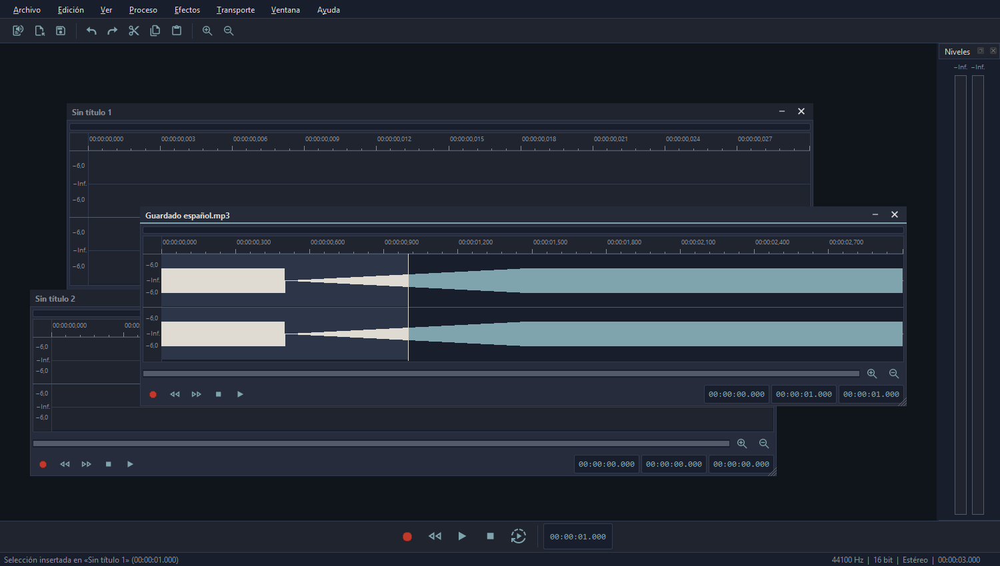
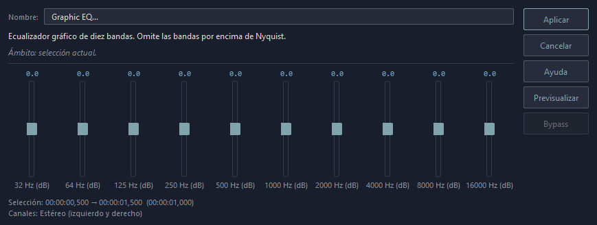
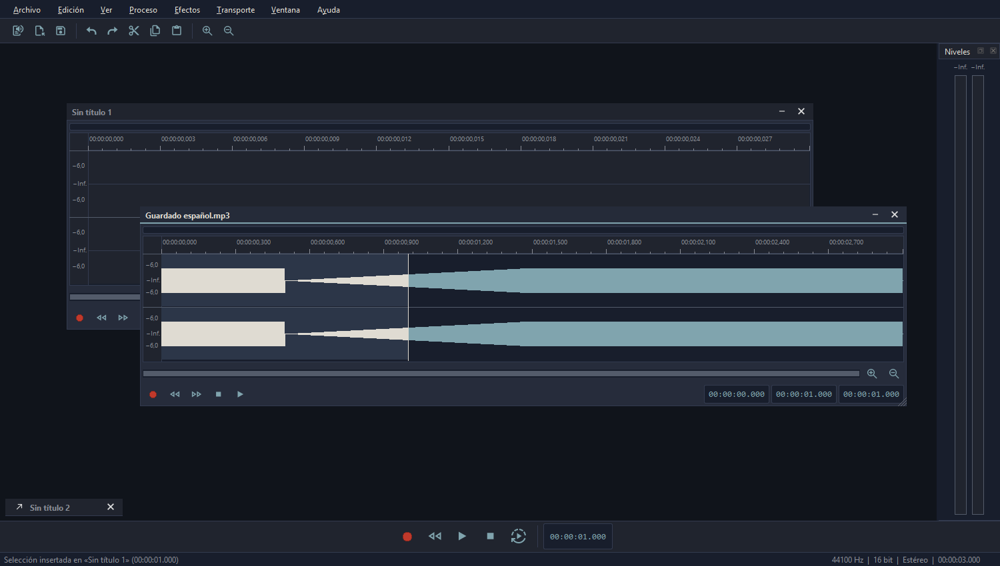
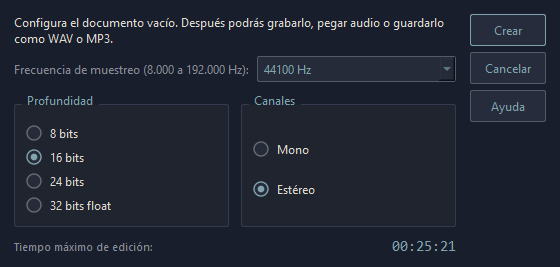
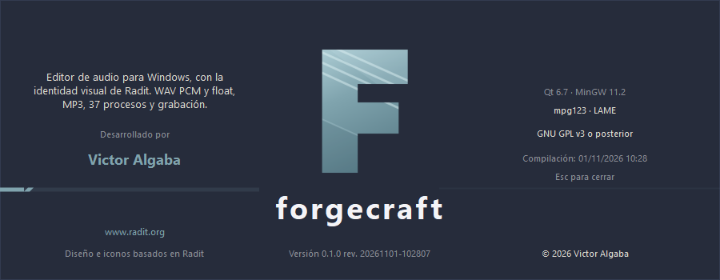
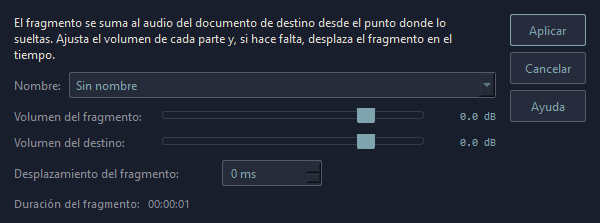
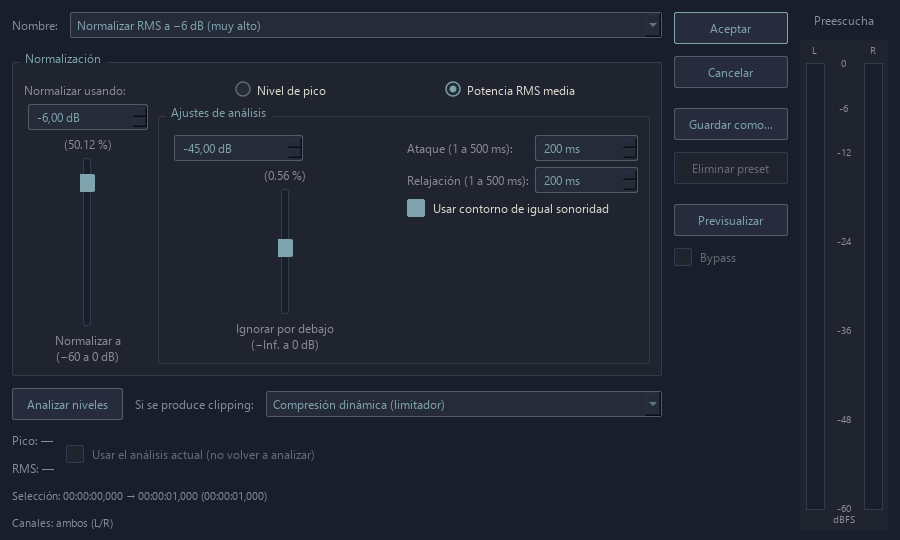

# ForgeCraft 0.1.7

Editor de audio para Windows, inspirado en la estética y el flujo de los editores clásicos como Sound Forge 4.5. Implementación propia en **Qt Widgets 6.7.0, C++17 y MinGW 11.2 de 64 bits**, el mismo kit configurado en Radit.



## Capturas

| | |
|---|---|
| [](forgecraft-proceso.png) | [](forgecraft-minimizado.png) |
| Diálogos de Proceso y Efectos con sliders, pie de selección y Previsualizar/Bypass. | Documento minimizado como botón al pie del área de trabajo. |
| [](forgecraft-nuevo.png) | [](forgecraft-acerca.png) |
| Documento nuevo: frecuencia, profundidad y canales. | Ventana «Acerca de» con la disposición de Radit. |
| [](forgecraft-mezcla.png) | [](forgecraft-normalizador.png) |
| Mezcla al arrastrar entre ventanas: volumen de cada parte y desplazamiento. | Normalizador Peak/RMS con presets y preescucha en bucle. |

## Descarga

[Descargar ForgeCraft 0.1.7 para Windows de 64 bits](https://github.com/valgaba/forgecraft/releases/download/forgecraft-0.1.7/forgecraft_0_1_7.zip). Descomprimir `forgecraft_0_1_7.zip` y ejecutar `forgecraft_0_1_7\forgecraft.exe`. No requiere instalación. El paquete incluye las DLL de Qt, los plugins, los códecs MP3, la hoja de estilo y las licencias; los detalles están en `README.txt` del propio paquete. La [página de la versión](https://github.com/valgaba/forgecraft/releases/tag/forgecraft-0.1.7) incluye la suma SHA256.

## Estructura

```text
forgecraft/
├── svn/                  Código fuente y proyecto de Qt Creator
│   ├── forgecraft.pro
│   ├── *.cpp, *.h        Editor, audio y pruebas
│   ├── style/            Hoja de estilo del tema
│   ├── icons/            Iconos SVG
│   ├── distribution/     Licencias y avisos de terceros
│   └── third_party/      Bibliotecas MP3, cabeceras y licencias
├── out/
│   ├── bin/              Ejecutable, DLL, plugins y licencias (no versionado)
│   ├── build/            Makefiles, objetos, moc y capturas (no versionado)
│   └── packages/         Paquetes generados (no versionado)
├── docs/                 Análisis de la identidad visual
├── build.ps1             Compilación y pruebas
├── package.ps1           Empaquetado y SHA256 para la Release
├── LICENSE               GPL-3.0
└── README.md
```

La carpeta `svn` organiza las fuentes con el mismo criterio que Radit. El nombre de la carpeta no implica que se haya creado un repositorio Subversion.

## Abrir

Ejecutar `out/bin/forgecraft.exe`. Mantener las DLL, las carpetas `platforms`, `iconengines` e `imageformats`, la carpeta `licenses` y la hoja `forgecraft.qss` junto al ejecutable. Las bibliotecas MP3 se incluyen en el proyecto y se copian al ejecutar `build.ps1 -Deploy`. Para los formatos adicionales, ejecutar primero `setup-codecs.ps1`; mantener también la carpeta `codecs` junto al ejecutable.
Para editar el proyecto en Qt Creator, abrir `svn/forgecraft.pro` y seleccionar el kit Desktop Qt 6.7.0 MinGW 64-bit.

## Interfaz

La apariencia sigue la identidad visual de Radit, según el análisis de `docs/analisis-estilo-radit.md`.

- `svn/style/forgecraft.qss` es la fuente principal del aspecto: paleta oscura (`#181e2c`, `#20242e`, `#252b39`), bordes `#333b4f`, texto `#dfdbd2`/`#8a8d96` y acento `#80A4AE`. Está versionada y se carga desde la carpeta del ejecutable, de modo que se puede ajustar sin recompilar; si falta, se usa la copia incrustada en `forgecraft.qrc`.
- `svn/theme.h` y `svn/theme.cpp` contienen lo que la hoja no alcanza: la paleta de respaldo de Qt (para las flechas y controles que dibuja el estilo), las constantes con nombre de la forma de onda y los medidores, y el acceso a los iconos.
- El icono de la aplicación es la letra **F** construida como la **R** de Radit: cuerpo con degradado, franjas diagonales y la letra como máscara. Se genera desde `svn/icons/ForgeCraftAppIcon.svg` + `ForgeCraftLogo.svg` con `svn/tools/build-brand-icon.cpp`, que produce `ForgeCraftAppIcon.png` (ventana y Acerca de) y `forgecraft.ico` (icono del ejecutable mediante `forgecraft.rc`). Para regenerarlo, compilar esa herramienta con el kit (`QtSvg`, `QtGui`, `QtCore`) y ejecutarla pasando `svn/icons` como argumento.
- **Ayuda → Acerca de ForgeCraft** abre la ventana `FormAbout`, con la disposición de Radit: descripción y autor a la izquierda, logotipo y versión en el centro, créditos y licencia a la derecha, y la línea de acento en la parte inferior.
- Los iconos son SVG del set de Radit (`svn/icons`), incrustados en `forgecraft.qrc` con nombre de recurso propio (`:/icons/play.svg`, `:/icons/open.svg`…). Se cargan con el motor de iconos SVG de Qt, así que la distribución incluye `Qt6Svg.dll`, el plugin `iconengines/qsvgicon.dll` y `imageformats/qsvg.dll`.
- El estilo de Qt es **Fusion**, que dibuja con la paleta y evita restos claros del tema nativo de Windows.
- Las subventanas MDI no usan el marco del sistema: cada módulo dibuja su barra de título (`Frame#framebarra`) con minimizar y cerrar. Arrastrar la barra mueve el módulo, el doble clic lo maximiza y los bordes izquierdo, derecho e inferior redimensionan el módulo; el puntero cambia de forma al entrar en la zona de agarre y una pequeña marca en la esquina inferior derecha lo recuerda. La franja de la barra de título queda reservada para mover, así que no redimensiona.
- Minimizar convierte el módulo en un botón bajo apoyado en el pie del área de trabajo, con la flecha de restaurar, el título recortado y el cierre, alineado en fila con los demás minimizados. El botón de restaurar o el doble clic lo devuelven a su tamaño y posición anteriores; los módulos minimizados no se arrastran ni los recolocan *Cascada* y *Mosaico*.
- Los diálogos de Proceso y Efectos siguen el patrón de los editores clásicos con la paleta de Radit: parámetros como sliders verticales (valor encima y etiqueta debajo; caja numérica cuando hay uno o dos parámetros), columna de botones a la derecha (Aplicar, Cancelar, Previsualizar y Bypass) y pie con la selección y los canales. Los rangos de más de dos décadas —frecuencias, duraciones— se reparten en escala logarítmica para que el slider sea manejable.
- Cada diálogo de Proceso y Efectos con parámetros incluye un **combo de presets en la parte superior, alineado con Aplicar**, **Guardar como…** y **Eliminar preset**. Se incluyen ajustes iniciales por operación (salas, halls y catedral para Reverb; slapback y ecos para Delay; voz y música para dinámica; curvas de EQ, formatos de remuestreo y otros). Los ajustes personales persisten entre sesiones y están separados por operación; los incluidos no se pueden sobrescribir ni eliminar. Al modificar un control aparece `(Sin título)`. Elegir un preset actualiza los controles y la preescucha en curso sin detenerla.
- **Previsualizar** reproduce en bucle el tramo de escucha sin aplicar cambios al documento. En todos los diálogos de Proceso y Efectos, los sliders, las cajas numéricas y las listas actualizan el resultado durante la reproducción: se recalcula en segundo plano y se publica el último ajuste con un fundido breve, conservando la salida de audio y su posición. **Bypass** alterna entre el resultado y el original; los cambios hechos en bypass estarán listos al volver al efecto. La escucha utiliza hasta 15 segundos de audio de la selección o del cursor, más las colas generadas por el efecto. Se detiene al pulsar Detener preescucha o cerrar el diálogo. Los cambios de frecuencia o canales se adaptan al formato de escucha sin modificar el formato real del documento.
- Los diálogos con preescucha incluyen un **vúmetro vertical L/R a la derecha**, con escala de −60 a 0 dBFS y nivel real de la salida, también en Bypass. **Resample** e **Insert Silence** no muestran preescucha, Bypass ni vúmetro. Las operaciones directas sin diálogo conservan su funcionamiento inmediato.
- **Normalize** tiene un diálogo propio inspirado en la referencia clásica: presets de pico y RMS (−12, −10 para voz, −16 para música y −6 dB), sliders verticales de objetivo y umbral, ataque/relajación de análisis (1–500 ms), análisis de pico/RMS reutilizable y la selección actual del MDI. El contorno de igual sonoridad es una aproximación perceptual propia, no una medición LUFS. La política de clipping permite limitación dinámica enlazada en estéreo, reducción de ganancia, saturación o cancelación. A la derecha hay vúmetros verticales L/R de preescucha en dBFS, alimentados por el audio que se reproduce, incluido el bypass. La preescucha del normalizador se repite en bucle hasta pulsar Detener preescucha o cerrar el diálogo. Los cambios de parámetros y de preset se recalculan en segundo plano, conservando el audio anterior hasta disponer del nuevo; se sustituyen mediante un fundido de 20 ms sin reabrir el dispositivo ni reiniciar la posición. La salida se rellena desde un hilo dedicado de alta prioridad, con 80 ms de cola y lectura de buffers compartidos sin copias; no depende del repintado de la interfaz. Bypass también conserva la posición. La ganancia de la preescucha se calcula sobre toda la selección aunque solo se escuchen sus primeros 15 segundos. Los presets personales se guardan en la configuración y pueden eliminarse. La normalización siempre crea una operación de deshacer y conserva el historial previo.
- En cada módulo, el desplazamiento de la vista ocupa la fila inferior y las lupas de acercar y alejar quedan a su derecha. El transporte inferior de la ventana principal usa iconos de 24 px.
- Los diálogos heredan el tema por sus `objectName` (`recordDialog`, `processDialog`, `processingProgress`) y los diálogos de **Abrir** y **Guardar como** usan los nativos de Windows.

Los valores de la hoja están ampliados respecto a Radit (barra de desplazamiento de 12 px, controles de 24 px) para que la interfaz siga siendo usable en pantallas de alta densidad.

## Funciones actuales

- El área de trabajo empieza vacía, sin un documento MDI predeterminado. Los documentos se crean con Nuevo, Abrir o al comenzar una grabación.
- **Seguir reproducción**: botón activable junto a Play en cada MDI y en el transporte inferior. Activado por defecto, fija la línea roja en el centro y desplaza la forma de onda por debajo de ella continuamente. En los extremos queda espacio vacío fuera del audio para conservar el centrado. Desactivado, la vista permanece fija y permite explorar el audio mientras sigue sonando. Cada MDI conserva su estado; el botón inferior controla el enfocado. Al reactivarlo, la vista se centra en la posición actual de reproducción.

- Ventanas de audio MDI superpuestas, con cascada y mosaico, con módulos de marco propio (barra de título con minimizar y cerrar, y bordes redimensionables).
- Interfaz oscura con la identidad visual de Radit: superficies planas, acento `#80A4AE` y formas de onda sobre lienzo oscuro con reglas de tiempo por documento.
- Los dos vúmetros estéreo horizontales están en el extremo derecho de la barra superior de **Archivo y edición**, con barras de hasta 380 píxeles, escala logarítmica de −60 a 0 dBFS y animación independiente a unos 60 fotogramas por segundo: un icono de **micrófono** identifica la entrada, que se mide continuamente aunque no se esté grabando, sin almacenar audio y otro de **altavoz** la salida de reproducción y previsualización. Ambos usan el estilo y el color de los iconos de Radit. Los iconos son botones de **mute** independientes: el micrófono silencia la entrada (durante la grabación se acumulan ceros, manteniendo su duración) y el altavoz silencia reproducción y preescucha sin detenerlas. Un segundo clic recupera la señal; una marca roja indica el mute. Se conserva el volumen previo de salida y el estado de mute al parar o cambiar de MDI. **Ver → Vúmetros** permite mostrarlos u ocultarlos. La barra de transporte inferior es común a todos los documentos. **Opciones → Opciones generales…** (Ctrl+,) permite elegir el **dispositivo de salida** (con un botón **Probar** que reproduce un tono) y el **dispositivo de grabación**; ambos se guardan para las próximas sesiones.
- Abrir WAV mono/estéreo PCM 8, 16, 24 y 32 bits, o float de 32 bits.
- Abrir MP3 mono/estéreo, incluidos archivos con bitrate variable.
- **Nuevo** abre un cuadro con frecuencia (8.000 a 192.000 Hz), profundidad (8, 16, 24 bits o 32 float), canales (mono/estéreo) y el tiempo máximo de edición; el documento se crea con ese formato.
- Guardar WAV en la profundidad del documento (8, 16, 24 bits o 32 float), con sustitución atómica del archivo.
- Guardar MP3 con LAME a 128, 192, 256 o 320 kbps CBR; cabecera LAME con duración y datos para reproducción sin huecos.
- Selección con ratón, doble clic para seleccionar todo, zoom y desplazamiento.
- Los extremos de la selección se arrastran: al acercar el puntero a uno de ellos cambia a flecha doble y se puede ampliar o reducir la selección desde ese borde, con el otro extremo fijo.
- Arrastrar una parte seleccionada fuera de la forma de onda la copia: si se suelta sobre el área de trabajo se abre un documento nuevo con ese fragmento, y si se suelta sobre otro módulo se coloca en su documento en el punto donde se suelta (deshacible allí). Mientras se arrastra, la barra de estado muestra la **duración del fragmento** y la ventana sobre la que se soltaría, y en esa ventana se dibuja el **fantasma del tramo al mezclar** o una **línea vertical al insertar**. Durante el arrastre, un **clic derecho manteniendo pulsado el izquierdo** alterna entre mezclar e insertar y actualiza la vista previa y la opción del menú. El documento de origen no cambia. **Edición → Al soltar en otra ventana** elige qué se hace: **Mezclar con el audio de destino** (por omisión) o **Insertar en el punto de destino**. Al mezclar se abre un cuadro con dos **sliders verticales** (volumen del fragmento y del destino, de silencio a +15 dB), presets (50/50, voz sobre mezcla, instrumento sobre mezcla), un **desplazamiento** de hasta medio segundo y **Previsualizar**, que reproduce la mezcla con los valores actuales sin aplicarla; la mezcla se satura a ±1 y amplía el documento si el fragmento sobrepasa el final. Cada mezcla es una sola operación de deshacer.
- Copiar o cortar una selección y pegarla en otro módulo, con el portapapeles compartido entre documentos.
- **Marcas de posición**: **M** inserta una marca en el cursor (Marca 01, Marca 02…), dibujada en **rojo** con un banderín en la regla, línea de puntos sobre la onda y su nombre y hora al pasar el puntero o al seleccionarla. **Doble clic** en el banderín la renombra; **botón derecho** sobre él abre el menú con **Renombrar** y **Eliminar**; **Mayús+M** elimina la más cercana al cursor. **Doble clic entre dos marcas** selecciona ese tramo. Las marcas se desplazan al insertar, pegar o recortar, y viajan con el audio al copiar o arrastrar un fragmento.
- Menú contextual con el botón derecho sobre el área de trabajo y sobre la forma de onda, con las mismas acciones que el menú Edición (deshacer, rehacer, cortar, copiar, pegar, eliminar, recortar y seleccionar todo).
- Los documentos sin archivo se numeran como `Sin título 1`, `Sin título 2`… con el primer número libre.
- Reproducción de selección o desde el cursor, bucle y medidor de pico digital.
- Cortar, copiar, pegar, borrar y recortar; deshacer/rehacer hasta 20 operaciones.
- Volumen, normalización, fundidos, inversión temporal y silencio.
- Generador de tono sinusoidal y aviso de cambios sin guardar.
- Arrastrar uno o varios archivos de audio compatibles sobre el escritorio de trabajo o una forma de onda abre una ventana nueva por archivo, sin sustituir el documento anterior.
- Campos de inicio, final y duración de selección en cada ventana.
- Grabación PCM de 16 bits con dispositivo de entrada, mono/estéreo, monitorización permanente de niveles, pausa/reanudación, límite de duración y ajuste DC automático.

Play y Stop de la barra inferior actúan sobre el MDI enfocado: Espacio alterna su reproducción y Esc detiene su reproducción o grabación. Stop no interrumpe la toma de otro MDI. Los botones dentro de cada módulo actúan sobre su propio documento. Ctrl+rueda cambia el zoom; rueda desplaza la vista. Sin selección, los procesos afectan a todo el audio; borrar y recortar requieren selección. Pegar requiere la misma frecuencia y número de canales, salvo en un documento vacío.

## Menús Proceso y Efectos

Las entradas conservan los nombres de las capturas para facilitar su identificación. Son implementaciones propias de estas familias de procesamiento, con resultados que pueden diferir de Sound Forge 4.5.

**Proceso:** Auto Trim/Crop con umbral y margen; Channel Converter (mezcla, extracción izquierda/derecha, duplicación mono); Convert to 8-Bit con dither TPDF opcional y exportación WAV de 8 bits; DC Offset; EQ gráfico de diez bandas y paramétrico; Fade de entrada, salida y envolvente; Insert Silence; inversión de polaridad e intercambio de canales; Mute; Normalize por pico; Pan/Expand; Resample con filtrado antialias; Reverse; Smooth/Enhance; Time Compress/Expand conservando tono; Volume.

**Efectos:** Amplitude Modulation; Chorus; Delay/Echo simple y ping-pong; Distortion suave/dura; Dynamics con compresor, expansor y limitador; Envelope; Flange y Wah-Wah; Gapper/Snipper; Noise Gate; Pitch Shift y Bend; Reverb; Vibrato.

Los efectos actúan sobre la selección, o sobre todo el audio si no hay selección. Channel Converter, Convert to 8-Bit y Resample siempre actúan sobre el documento completo. Insert Silence inserta en el cursor/inicio de selección. Las colas de eco y reverberación se añaden al final de la región procesada, antes del audio posterior; su duración puede ponerse a cero. Los efectos estéreo específicos requieren dos canales. La envolvente permite ajustar tres puntos de ganancia y la posición del punto intermedio.

Los diálogos permiten ajustar los parámetros. El procesamiento se ejecuta en un hilo de trabajo con cancelación y se registra como una operación de deshacer. Cancelar conserva el audio anterior. La salida se limita al rango digital −1 a +1; los aumentos de nivel pueden saturar. Los algoritmos de tiempo/tono usan solapamiento y alineamiento de ondas; Pitch Bend es granular y no incluye preservación de formantes. La forma de onda utiliza una caché de picos para agilizar el redibujado de archivos largos.

Referencias técnicas: filtros biquad según el [Audio EQ Cookbook del W3C](https://www.w3.org/TR/audio-eq-cookbook/). La implementación de tiempo/tono es propia y no incorpora SoundTouch ni otras bibliotecas DSP.

## Sesiones largas

Se admiten archivos de más de seis horas. Ya no se aplica el límite de 512 MB de audio descomprimido. Los bloques de muestras mayores de 8 MB utilizan temporales en la carpeta temporal de Windows y paginación del sistema; los bloques pequeños permanecen en RAM. El historial de deshacer y los recortes comparten esos archivos, que se liberan al cerrar la última versión que los utiliza. Los procesos y la forma de onda de documentos grandes se preparan en segundo plano. Deshacer y rehacer reutilizan las cachés de picos.

La reproducción de audio grande utiliza un hilo dedicado y una cola de cuatro bloques de 20 ms, con posiciones de 64 bits. No requiere convertir ni enviar toda la sesión en un único búfer de Windows. El guardado WAV se escribe por bloques; cuando supera los 4 GB de RIFF se exporta automáticamente como RF64, conservando la extensión WAV y la profundidad elegida. También puede seleccionarse RF64 explícitamente.

Hace falta espacio libre para el audio descomprimido, las versiones editadas y los temporales de exportación. Como referencia, siete horas a 44.100 Hz estéreo ocupan unos 8,9 GB en muestras float de 32 bits. Los procesos que cambian todo el documento pueden crear otra versión de ese tamaño; cerrar documentos libera sus temporales y su historial. El límite de 256 GB es por versión de audio y no una reserva inicial.

`--large-audio-test -platform offscreen` comprueba almacenamiento compartido y limpieza, WAV de siete horas, edición y cancelación, RF64 mayor de 4 GB, MP3 real de siete horas y transporte estéreo con acceso más allá de 4 GB. Genera únicamente audio sintético en temporales de pruebas.

## Abrir y guardar audio

Abrir y Guardar como utilizan los **diálogos nativos de Windows**, con filtros por formato. Se puede importar y exportar WAV, MP3, AIFF/AIFC, AU/SND, CAF, Wave64, RF64, RAW/PCM, FLAC, WavPack, Ogg Vorbis, Opus, AAC/ADTS, M4A/AAC, AC3, AMR de banda estrecha, WMA v2, MP2, Matroska/FLAC y WebM/Opus. También se puede extraer la primera pista de audio de archivos compatibles con FFmpeg (por ejemplo MP4 y MKV); las pistas con más de dos canales se mezclan a estéreo. No se importan proyectos AUP/AUP3 ni archivos MIDI.

La exportación permite elegir frecuencia, canales y, según el formato, bitrate, profundidad PCM o compresión sin pérdida. AMR se exporta a 8 kHz mono, Opus/WebM y AC3 a 48 kHz; los otros codificadores con frecuencias discretas usan 44,1 kHz en el diálogo. RAW pide codificación, frecuencia y canales al abrir y guardar. El documento en memoria conserva su formato. Se muestra progreso de guardado y se puede cancelar; el archivo anterior se sustituye solo al completar correctamente la exportación. No se conservan metadatos ni carátulas de los originales.

Para los formatos adicionales se distribuyen ffmpeg.exe y ffprobe.exe en **codecs/**. Antes del primer despliegue desde el código fuente, ejecutar `./setup-codecs.ps1` (requiere 7-Zip); verifica el SHA256 del archivo descargado. `build.ps1 -Deploy` y `package.ps1` incluyen las herramientas y sus licencias. WAV y MP3 siguen usando los códecs propios.

Al abrir un archivo de audio aparece una barra de progreso con el nombre del archivo y el porcentaje de carga. Incluye la lectura/decodificación y la preparación de la forma de onda, realizadas en segundo plano. **Cancelar** interrumpe la carga sin modificar los documentos abiertos. También se muestra al cargar archivos arrastrándolos al editor.

La carga evita copias completas innecesarias y Play utiliza las muestras directamente cuando la salida admite float32, con compatibilidad PCM16. El primer clic reinicia también una reproducción que acaba de terminar, aunque el temporizador aún no haya limpiado su estado. Si se cambia el cursor o la selección mientras suena audio, Play en los controles comunes reinicia desde el nuevo tramo con una sola pulsación. La barra común incluye Ir al inicio e Ir al final (Home/End) y prescinde del botón de bucle. Mediciones y alcance de las pruebas: [rendimiento de audio](docs/rendimiento-audio.md).

Usar **Archivo → Abrir audio** para seleccionar uno o varios archivos; cada archivo abre su propio MDI. Para convertir un WAV a MP3, usar **Archivo → Guardar como** y elegir **Audio MP3**; al cambiar el filtro se adapta la extensión. Al guardar se pide la calidad, con 192 kbps como valor inicial. Guardar un documento abierto desde MP3 conserva ese formato y permite elegir de nuevo la calidad.

La exportación conserva 32.000, 44.100 o 48.000 Hz. Para otras frecuencias, LAME convierte a 44.100 Hz tras avisar al usuario; el documento en memoria no se remuestrea. La exportación codifica el audio editado completo y no conserva etiquetas ID3 ni carátulas. MP3 usa compresión con pérdida; para evitar sucesivas recodificaciones, conservar un original WAV cuando sea necesario.

Los codecs `libmpg123-0.dll` y `libmp3lame-0.dll` se cargan desde la carpeta del ejecutable. No se necesita instalar un reproductor, FFmpeg ni Audacity. Los avisos de copyright, las licencias y los enlaces a los proyectos y fuentes están en `svn/third_party/mp3/NOTICE.md` y se despliegan en `out/bin/licenses`.

## Grabación

Pulsar **Ctrl+R**, el botón rojo de la barra de transporte inferior o el de una ventana de audio. **No hay cuadro de grabación**: se graba directamente en el documento enfocado, que se crea si no hay ninguno («Grabación 1», «Grabación 2»…).

1. La entrada se elige en **Opciones → Opciones generales… → Grabación**. La captura usa PCM de 16 bits mediante la API `waveIn` de Windows.
2. El formato sale del documento: si ya tiene audio se usa su frecuencia y sus canales; si está vacío, 44.100 Hz estéreo.
3. El **vúmetro de Entrada** mide continuamente el dispositivo seleccionado; mientras se graba sigue mostrando su nivel y la barra de estado el tiempo acumulado. Volver a pulsar Grabar detiene la captura. Stop o **Esc** en la barra inferior la detienen cuando está enfocado el MDI que graba; el Stop de ese módulo también la detiene.
4. Al detener, la toma se añade **al final del documento** como una operación de deshacer; lo que ya había no se toca.

El **ajuste DC** (filtro paso alto a 20 Hz) va siempre activo: quita la componente continua que algunas entradas añaden. Las tomas grandes usan almacenamiento temporal en disco, con una capacidad máxima de 256 GB de muestras por versión, condicionada al espacio libre. Si la toma no cabe en el documento se avisa y no se modifica nada.

Los errores de entrada se muestran en un aviso, sin tocar el documento. Si Windows bloquea el micrófono, revisar sus permisos para aplicaciones de escritorio en **Configuración → Privacidad → Micrófono**. Esta versión no incorpora grabación remota, sincronización externa ni escucha de entrada por los altavoces.

Las pruebas automáticas de grabación usan una fuente PCM sintética y verifican la conversión de PCM, el filtro DC, el límite de duración, la mezcla en el documento y los errores de dispositivo. No activan el micrófono: la captura física debe comprobarse con un dispositivo real.

## Compilar y verificar

Desde PowerShell en esta carpeta:

```powershell
.\build.ps1 -Deploy -Test
```

El script vive en la raíz y hace todo el proceso (qmake, mingw32-make, despliegue y pruebas), como el de Sessions. Usa el kit instalado en `C:\Qt`. Copia en `out/build/tools` los binutils de reemplazo que ya utiliza Radit para evitar el problema del cargador de Windows con el ensamblador antiguo. Antes de usarlos comprueba que enlazan un programa trivial; si esa comprobación falla (algunas versiones de binutils de MSYS2 fallan con `lseek: Bad file descriptor`), compila con las herramientas del propio kit de Qt y avisa por consola. Las dependencias de esas herramientas se encuentran en `C:\msys64\mingw64\bin`. No modifica Radit ni la instalación de Qt.

`-Destination` permite desplegar en otra carpeta (por omisión, `out\bin`).

`-Deploy` copia también `svn/style/forgecraft.qss` junto al ejecutable, para poder ajustar el tema sin recompilar, y los componentes que necesitan los iconos: `Qt6Svg.dll`, `iconengines/qsvgicon.dll` e `imageformats/qsvg.dll`.

Prueba de integración de la interfaz (con las DLL desplegadas):

```powershell
Start-Process .\out\bin\forgecraft.exe -ArgumentList '--smoke-test' -Wait
```

`-Test` ejecuta las pruebas de audio y de interfaz. Genera `out/build/preview.png`, `out/build/minimized.png`, `out/build/process-dialog.png`, `out/build/process-dialog-eq.png`, `out/build/process-menu.png` y `out/build/effects-menu.png`. Comprueba edición, ventanas MDI (arrastre desde la barra de título, redimensionado por el borde con su cursor, minimizar al pie del área de trabajo y restaurar, activación al pulsar), la selección de la onda (se conserva al soltar, sus extremos se redimensionan con el cursor de flecha doble, arrastrarla fuera abre un documento y soltarla en otro módulo la inserta), copiar y cortar entre módulos, el menú contextual de Edición y la numeración de los documentos sin título, guardado MP3, los 37 procesos aplicados y deshechos desde sus menús, los controles de previsualización de los diálogos, cancelación de diálogo/trabajo y arrastre múltiple de WAV+MP3 sobre una forma de onda. La imagen muestra audio sintético de prueba. `--self-test` verifica exportación/reapertura de todos los formatos del catálogo, precisión sin pérdida y cancelación que conserva el destino, además de conversión WAV/MP3, los cuatro bitrates, integridad fuera de selección, filtros antialias, posiciones de ecos, colas de reverberación, techo del limitador, duración/frecuencia al cambiar tiempo y tono, y el formato WAV de 8 bits con padding.

## Empaquetar y publicar

Con el ejecutable ya desplegado:

```powershell
.\package.ps1 -Version 0.1.7
```

Genera `out/packages/forgecraft_0_1_7.zip` con el ejecutable, la hoja de estilo, las DLL, los plugins (`platforms`, `iconengines`, `imageformats`), los códecs MP3, la carpeta `codecs` con FFmpeg y ffprobe, las licencias y los textos de instalación, y escribe `out/packages/SHA256SUMS.txt`. Ese zip y el archivo de sumas son los dos assets que se adjuntan a la Release; los binarios no se guardan en el repositorio.

## Alcance de esta versión

Todavía no reproduce todas las funciones de Sound Forge 4.5. Pendientes: automatización avanzada de curvas, grabación remota/sincronizada y plugins externos. Los datos de audio y las cachés grandes se almacenan en temporales mapeados en disco. Copias, selecciones y versiones de deshacer comparten datos hasta modificarlos; una selección se puede editar sin copiar su fuente completa. La capacidad es de 256 GB de muestras por versión, condicionada al espacio libre de la carpeta temporal de Windows. El guardado WAV respeta la profundidad del documento: 8, 16, 24 bits o 32 float. Reproducción mediante la API waveOut de Windows; el medidor muestra picos de muestras, no true peak. No incorpora código, marcas gráficas ni recursos del programa original.

## Licencia

ForgeCraft se distribuye bajo **GNU General Public License versión 3**; el texto completo está en [LICENSE](LICENSE). Usa Qt 6.7 (GPLv3/LGPLv3), el runtime de MinGW 11.2 y GCC, mpg123 (LGPL 2.1) y LAME (LGPL 2 o posterior). Los avisos y los textos completos están en `svn/distribution/THIRD_PARTY_NOTICES.txt` y `svn/distribution/licenses/`, y se incluyen en cada paquete.

